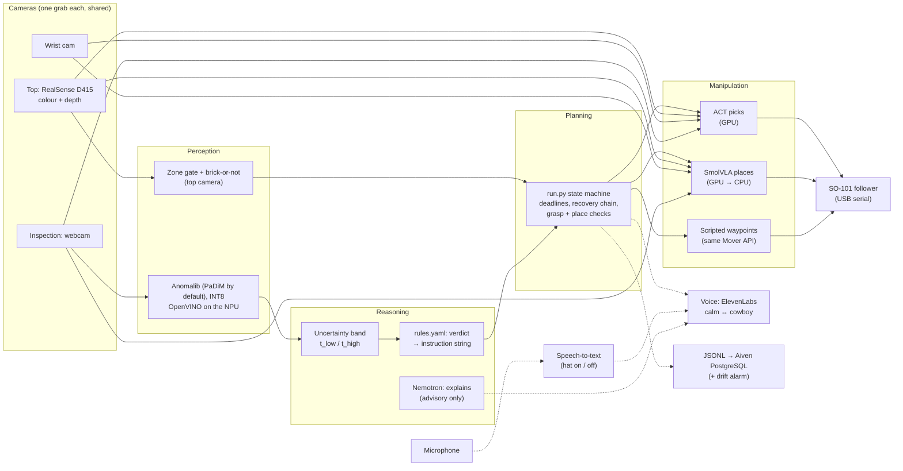

# SortSense

A closed-loop defect-sorting robot with a personality, built at **Junction 2026** (Espoo) for the
**Intel x Ignite Next: Physical AI** track.

An SO-101 follower arm picks a Duplo brick and holds it up to an inspection camera (ACT policy). Anomalib scores
it **perfect**, **defective** or **uncertain**. The verdict becomes a language instruction, and SmolVLA (a
vision-language-action model) places the brick in the **purple bowl** (perfect) or the **orange bowl**
(defective). Everything runs on one Intel Core Ultra laptop with OpenVINO, each model on the NPU, GPU or CPU on
purpose.

On top of that, the robot explains its reasoning out loud, live, with its real numbers ("That scores 0.41, over my
0.33 line, with a mark at the top left. Orange bowl."). In the demo it starts out of reach of the bricks, says so,
and drags its wheeled base across a white box room to them. The robot is called **Pix**: say "Hey Pix, what do
you see now?" and it tells you, or "Hey Pix, I'm putting a cowboy hat on you" and it puts on a cowboy voice until
you say the hat is off.

> **Status:** the mock loop runs end to end; the real station is being brought up. Measured numbers live in
> [`bench/results.md`](bench/results.md); anything not measured yet is marked TBD.

## Architecture



Solid arrows are the control path, which runs on the laptop's CPU and never waits on the network. Dotted arrows
are side threads: the voice and the event log never block a state transition.

**State machine:** `IDLE → LOCATE → PICK → VERIFY_GRASP → INSPECT → DECIDE → [REINSPECT] → PLACE → VERIFY_PLACE → LOG → next`.
Any failure goes `HOME`, says why out loud, and waits for a person (**P** carries on, **Q** stops).

**Uncertain bricks** get, in order: a fresh look with the same camera, a 90° wrist roll and re-score, a re-grasp.
Still uncertain → orange bowl, flagged and said aloud.

### Where each model runs

| Workload | Device | Why | Fallback |
|---|---|---|---|
| Anomalib (static 1×3×256×256, INT8) | **NPU** | Small convolutional net with static shapes, low power, frees the GPU | GPU → CPU |
| ACT | **GPU** | Transformer, called every control tick | CPU |
| SmolVLA (450M parameters) | **GPU** | The heaviest model | CPU (f32) → PyTorch |
| Capture, state machine, serial | **CPU** | Control-critical | — |

Measured on the Intel laptop (`python -m bench.benchmark`, full table in [`bench/results.md`](bench/results.md)),
detector PaDiM INT8 trained on stand-in bricks (re-run on the real-brick model pending):

| Device | p50 per inference | Net energy per inference | Package power | 5 min at full load |
|---|---|---|---|---|
| GPU | 1.00 ms | 33 mJ | 31.6 W | slows to 1.43× |
| NPU | 7.17 ms | 68 mJ | 11.2 W | holds (0.96×) |
| CPU | 8.91 ms | 300 mJ | 34.9 W | 1.06× |
| PyTorch on CPU (baseline) | 17.27 ms | 836 mJ | 37.9 W | — |

ACT (Studio export, our three cameras) compiles on the NPU in 2.3 s and runs in 8.9 ms per call (GPU 4.2 ms).
Physical AI Studio, used to record and train the policies, is part of Intel's Robotics AI Suite. Every real run
logs its own energy, average power, peak temperature and joules per brick; energy per brick and bricks per minute
over the 20 trials: TBD.

## Run it

Python 3.12. On Windows set `PYTHONUTF8=1`.

```bash
uv venv --python 3.12 .venv
uv pip install --python .venv --index-strategy unsafe-best-match -r requirements.txt
cp .env.example .env   # then add your own keys; never commit .env
```

| Command | What it does |
|---|---|
| `make mock` | The whole loop with stand-in cameras, inspector and arm. No hardware |
| `python run.py --mock --headless` | Same, without a window |
| `python run.py --scripted pick,place` | Real station, scripted motion |
| `make run` | Real station: ACT picks, SmolVLA places |
| `make rebaseline` | Re-train the detector on the demo table after a lighting change (~60 images) |
| `python -m bench.benchmark` | Device benchmark table |
| `pytest -m "not slow"` | Tests |
| `python run.py --mock --drive 42` | Rehearse the box-room opening: a stand-in base "drives" 42 cm first, talked over live |
| `--no-live` / `--no-listen` | Cached voice lines only (no ElevenLabs calls) / don't listen to the microphone |
| `python run.py --scripted pick,place --base` | Real run that opens with the arm stroking its wheeled board into the dock (needs `config/dock.yaml` and the four drive poses) |

**Keys in the window:** **S** start · **P** pause · **E** e-stop (torque off) · **Q** home and quit · **H** cowboy hat on/off (backup for saying it).

The screen and the log always say what moved the arm (`pick: scripted | place: smolvla on GPU`). A scripted
placement is never presented as SmolVLA.

### Station setup

Every step, in order, with how to tell it worked: [`docs/station.md`](docs/station.md). The demo itself:
[`docs/demo-script.md`](docs/demo-script.md).

## The personality layer: Pix

Pix is dry and deadpan; cowboy Pix is folksy. Every line says the facts first (score, threshold, mark, bowl), then
the joke ("That scores 0.41, over my 0.33 line, with a mark at the top left. I don't make the rules. Well, I do.
Orange bowl."). Several wordings per moment, chosen by the brick, so twenty bricks don't repeat. The e-stop line
stays plain.

- **It explains as it works, live, unprompted:** why it picks the brick it picks and the tally so far; each verdict with its score, the threshold it crossed and where the mark is;
  the running tally between bricks; the borderline score before each recovery step; how far it has to drive and,
  on arrival, how far and how long it took; a spoken summary of the run. These lines are synthesised on the fly
  with ElevenLabs Flash, several at once and never out of order (0.5–1.6 s per line on a good connection).
- **It never goes silent:** every line also exists as a cached clip in both voices (`narrator/clips/`). A line
  not back within 3 s, a network drop or a spent budget (12,000 characters per run) plays the cached clip instead;
  the arm never waits for speech.
- **You can talk to it:** the microphone is cut into utterances by loudness and sent to ElevenLabs speech-to-text
  (about 0.7–1.3 s). Pix acts only on sentences that name it: "Hey Pix, what do you see now?", "…how many have you
  sorted?", "…why that bowl?", "…what are you doing?", "…who are you?", and "Hey Pix, I'm putting a cowboy hat on
  you" / "…I'm taking the hat off" for the cowboy voice. Answers come from what it knows right now (stage, last
  score and threshold, tally), so they are instant and always true. **H** toggles the hat if the room is too loud.
- **You can interrupt it:** "Hey Pix, …" while it talks cuts it off mid-sentence and it answers you (about
  0.4 s after the interruption); an echo guard stops it answering its own voice.
- **It sees what's in front of it:** `narrator/vision.py` runs CLIP's image encoder locally through OpenVINO and
  names what the wrist camera shows (brick, plate, purple or orange bowl, or "unknown" with a best guess); zero-shot
  out of the box, then a small classifier trained on our own photos on the Intel laptop in seconds
  (`docs/station.md` 5b). Something on the plates that isn't a brick gets an instant "Holy smokes!".
- **Loud and even:** the calm voice came out of ElevenLabs 12.6 dB quieter than the cowboy, so every line is
  levelled to -12 dBFS with a soft ceiling (`narrator/loudness.py`).
- **Microphone check:** `python -m narrator.listen` shows a loudness bar, prints what it heard and what Pix
  understood, and speaks Pix's reply.
- **Subtitles and reasoning panel:** what it is saying runs under the camera feed (amber for the cowboy), and each
  brick's chain (score vs thresholds, every recovery step, the decision) is shown and logged.

## Event log and Aiven

Every stage writes one row to `runs/events.jsonl` (run, brick, state, label, score, device, latency, outcome,
note). A side thread ships new rows to **Aiven for PostgreSQL** (and Kafka when configured); offline, rows wait in
the file and catch up later. After each batch the database is asked for this run's perfect bricks, and the
**lighting drift alarm** fires when they creep towards `t_low`: the robot says "please rebaseline me" and
mission control shows a banner. The arm keeps going. `telemetry/report.sql` turns the table into the trial
report.

## Repo layout

| Path | What | Owner |
|---|---|---|
| `run.py`, `common/`, `fallback/`, `ui/`, `narrator/`, `telemetry/`, `config/` | Orchestration, scripted fallback, mission control, voice, event log | Harry |
| `perception/`, `bench/`, `reasoner/` | Anomalib, OpenVINO export and benchmarks, Nemotron reasoner | Saliha |
| `robot/`, `policies/`, `train/` | Robot I/O, ACT and SmolVLA, Modal training | Nate |

## Team

**Saliha** (AI/ML) · **Nate** (robotics and robot learning) · **Harry** (systems and integration).

## Licence

MIT, see [`LICENSE`](LICENSE).
