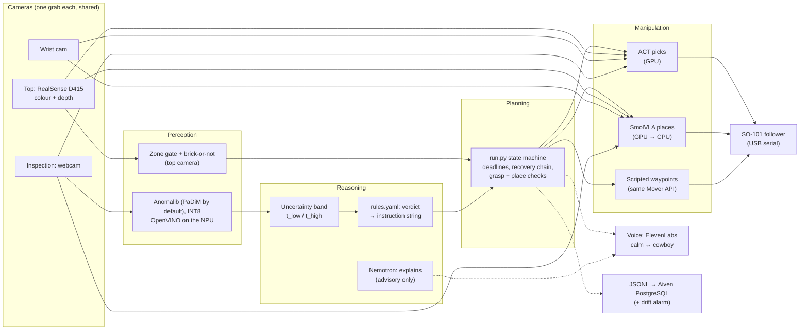

# SortSense

A closed-loop defect-sorting robot with a personality, built at **Junction 2026** (Espoo) for the
**Intel x Ignite Next: Physical AI** track.

An SO-101 follower arm picks a Duplo brick and holds it up to an inspection camera (ACT policy). Anomalib scores
it **perfect**, **defective** or **uncertain**. The verdict becomes a language instruction, and SmolVLA (a
vision-language-action model) places the brick in the **purple bowl** (perfect) or the **orange bowl**
(defective). Everything runs on one Intel Core Ultra laptop with OpenVINO, each model on the NPU, GPU or CPU on
purpose.

On top of that, the robot explains its reasoning out loud in a calm voice. An obstacle in the workspace, or the
cowboy hat, flips it into a cowboy persona ("Holy smokes!") until the moment passes.

> **Status:** the mock loop runs end to end; the real station is being brought up. Measured numbers will land in
> `bench/results.md`; until then every number below is marked TBD.

## Architecture



Solid arrows are the control path, which runs on the laptop's CPU and never waits on the network. Dotted arrows
are side threads: the voice and the event log never block a state transition.

**State machine:** `IDLE → LOCATE → PICK → VERIFY_GRASP → INSPECT → DECIDE → [REINSPECT] → PLACE → VERIFY_PLACE → LOG → next`.
Any failure goes `HOME`, says why out loud, and waits for a person (**P** carries on, **Q** stops).

**Uncertain bricks** get, in order: a fresh look with the same camera, a 90° wrist roll and re-score, a re-grasp.
Still uncertain → orange bowl, flagged and said aloud.

### Where each model runs

| Workload | Device | Why | Fallback |
|---|---|---|---|
| Anomalib (static 1×3×256×256, INT8) | **NPU** | Small convolutional net with static shapes, low power, frees the GPU | GPU → CPU |
| ACT | **GPU** | Transformer, called every control tick | CPU |
| SmolVLA (450M parameters) | **GPU** | The heaviest model | CPU (f32) → PyTorch |
| Capture, state machine, serial | **CPU** | Control-critical | — |

Latency, energy per brick and bricks per minute: TBD, measured on the Intel laptop (`python -m bench.benchmark`).

## Run it

Python 3.12. On Windows set `PYTHONUTF8=1`.

```bash
uv venv --python 3.12 .venv
uv pip install --python .venv --index-strategy unsafe-best-match -r requirements.txt
cp .env.example .env   # then add your own keys; never commit .env
```

| Command | What it does |
|---|---|
| `make mock` | The whole loop with stand-in cameras, inspector and arm. No hardware |
| `python run.py --mock --headless` | Same, without a window |
| `python run.py --scripted pick,place` | Real station, scripted motion |
| `make run` | Real station: ACT picks, SmolVLA places |
| `make rebaseline` | Re-train the detector on the demo table after a lighting change (~60 images) |
| `python -m bench.benchmark` | Device benchmark table |
| `pytest -m "not slow"` | Tests |

**Keys in the window:** **S** start · **P** pause · **E** e-stop (torque off) · **Q** home and quit · **H** cowboy hat.

The screen and the log always say what moved the arm (`pick: scripted | place: smolvla on GPU`). A scripted
placement is never presented as SmolVLA.

### Station setup

1. Camera paths in `config/cameras.yaml` (`ls /dev/v4l/by-id/`), the follower's port in `config/robot.yaml`.
2. `python -m ui.click_regions`: click the pick zone and both bowls on the top camera.
3. `python -m fallback.teach home pick_above pick pick_drop inspect bowl_red bowl_blue`: hand-guide each pose.
   Pose names are roles: `bowl_blue` is the purple (perfect) bowl, `bowl_red` the orange (defective) one.

## The personality layer

- **Voice:** every event and every failure reason has a line in two personas, pre-generated with ElevenLabs into
  `narrator/clips/` so it works offline. Playback runs on its own thread; the newest line wins, but help and
  e-stop lines are never dropped.
- **Cowboy switch:** an obstacle in the pick zone or the **H** key flips to the cowboy at once. It drifts back to
  calm through a half-way line once the obstacle has gone and one more brick is done.
- **Reasoning panel:** each brick's chain (score vs thresholds, every recovery step, the decision) is shown on
  screen and logged.

## Event log and Aiven

Every stage writes one row to `runs/events.jsonl` (run, brick, state, label, score, device, latency, outcome,
note). A side thread ships new rows to **Aiven for PostgreSQL** (and Kafka when configured); offline, rows wait in
the file and catch up later. After each batch the database is asked for this run's perfect bricks, and the
**lighting drift alarm** fires when they creep towards `t_low`: the robot says "please rebaseline me" and
mission control shows a banner. The arm keeps going. `telemetry/report.sql` turns the table into the trial
report.

## Repo layout

| Path | What | Owner |
|---|---|---|
| `run.py`, `common/`, `fallback/`, `ui/`, `narrator/`, `telemetry/`, `config/` | Orchestration, scripted fallback, mission control, voice, event log | Harry |
| `perception/`, `bench/`, `reasoner/` | Anomalib, OpenVINO export and benchmarks, Nemotron reasoner | Saliha |
| `robot/`, `policies/`, `train/` | Robot I/O, ACT and SmolVLA, Modal training | Nate |

## Team

**Saliha** (AI/ML) · **Nate** (robotics and robot learning) · **Harry** (systems and integration).

## Licence

MIT, see [`LICENSE`](LICENSE).
