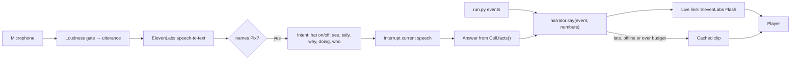

# How SortSense works

A walk through the whole codebase: what each part does, how it does it, and why it is built that way. Start with
**one brick, end to end**; every later section goes one layer deeper. Owners: **Saliha** (perception, benchmarks,
reasoner), **Nate** (robot I/O, learned policies, training), **Harry** (the loop, fallback, mission control, voice,
telemetry). The design decisions referenced as D1–D36 are written up, with the alternatives we rejected, in the team's
decision log.

## 1. One brick, end to end

```mermaid
sequenceDiagram
    participant Loop as run.py (control thread)
    participant Cam as SharedCapture
    participant Scene as perception.scene
    participant Arm as Mover (ACT / scripted)
    participant Det as perception.inspector (NPU)
    participant Place as Mover (SmolVLA / scripted)
    participant Voice as narrator (own threads)
    participant Log as telemetry (own thread)
    Loop->>Scene: LOCATE: next_brick() on the top frame
    Scene-->>Loop: brick with the most room, obstacles
    Loop-)Voice: "That's 2 sorted… next I'll take the one furthest from the rest"
    Loop->>Arm: PICK: pick_and_present()
    Loop->>Arm: VERIFY_GRASP: gripper inside the holding band?
    Loop-)Voice: "Got it. Firm but polite."
    Loop->>Cam: frame("inspect", newer_than=after the arm settled)
    Loop->>Det: INSPECT: inspect(frame) → DefectSignal
    Loop->>Loop: DECIDE: score vs t_low / t_high (look again, roll, re-grasp if unsure)
    Loop-)Voice: "That scores 0.41, over my 0.33 line… Orange bowl."
    Loop->>Place: PLACE: place("the brick is defective, place it in the orange bowl")
    Loop->>Arm: HOME, then VERIFY_PLACE: did the orange bowl region change?
    Loop-)Log: one events row per stage (label, score, device, latency, outcome, reason)
```

1. **LOCATE** (`perception/scene.py`): the overhead camera finds saturated colour blobs inside the taped zone, maps
   them to table centimetres through a homography of the clicked zone corners, keeps blobs whose area, aspect and
   solidity match a Duplo brick, and picks the **most isolated** one (safest to grasp). Anything else in the zone is
   an obstacle: never picked, and Pix reacts to it.
2. **PICK + VERIFY_GRASP**: the picker (ACT, or the scripted waypoints) brings the brick to the inspection pose. The
   grip counts only if the gripper reading sits inside a holding band after a 0.3 s settle (`robot.io.holding`):
   fully closed means it closed on nothing, open means it dropped it. One retry, then ask for help.
3. **INSPECT** (`perception/inspector.py`): the inspection camera's frame, taken after the arm stopped, is cropped
   exactly as the training photos were, scored by Anomalib (PaDiM, INT8) through OpenVINO on the **NPU**, and turned
   into a `DefectSignal`: label, raw score, both thresholds, the defect's bounding box, heatmap, device and latency.
4. **DECIDE**: below `t_low` is perfect, above `t_high` defective, in between unsure. Unsure runs a fixed recovery
   chain: a fresh look without moving, then a 90° wrist roll, then a re-grasp; still unsure means the orange bowl,
   flagged and said aloud. The verdict becomes the instruction string from `config/rules.yaml`.
5. **PLACE + VERIFY_PLACE**: the placer (SmolVLA, or scripted) is given the **instruction text**, so the inspection
   result literally becomes what the policy is asked to do. The arm then goes home and the top camera checks that the
   named bowl's region changed (`scene.brick_in_bowl`), because right after a place the arm hides the bowl.
6. **LOG**: every stage wrote a row; the brick's reasoning chain becomes the row's note and the on-screen panel.

All of this runs on one **control thread**. Cameras, speech, listening, logging and the Aiven upload each run on their
own threads, so nothing the robot says or uploads can delay a motion.

## 2. Where the code lives

| Folder | What it does | Owner |
|---|---|---|
| `run.py` | The state machine (`Cell`), the stage deadlines, recovery, help, and wiring of every part for a real or mock run | Harry |
| `common/` | Contracts (`interfaces.py`), shared camera capture, e-stop flag, stage deadline, reason codes, mocks | Harry |
| `fallback/` | Scripted mover (taught waypoints) and the hand-guided teaching tool | Harry |
| `ui/` | Mission control window, and the tool to click the zone and bowls | Harry |
| `narrator/` | Pix's voice: lines, live synthesis, persona, listening, answers, object recognition, loudness | Harry |
| `telemetry/` | Event log, Aiven upload and drift alarm, drive reliability report, Aiven check | Harry |
| `perception/` | Capture, audit, train, evaluate, export, inspector, scene check, thresholds, drift rule, statistics | Saliha |
| `bench/` | Device benchmarks, operator support, power and thermal, ACT-on-NPU probe, trial report | Saliha |
| `reasoner/` | Nemotron 3.5 Super VL: one grounded spoken line per brick, and its evaluation | Saliha |
| `robot/` | The one door to the SO-101 follower (`io.py`), the box-room drive, the end-of-run dance, pose tools | Nate |
| `policies/` | Learned mover: ACT picks, SmolVLA places, through exported OpenVINO models | Nate |
| `train/` | Dataset audit and cards, Modal training (ACT, SmolVLA, sweeps), export and parity checks | Nate |
| `config/` | Cameras, robot port and calibration, rules, models, clicked regions, waypoints, voices | shared |

The **contracts** in `common/interfaces.py` were frozen early so the three of us could build in parallel:

```python
DefectSignal(brick_id, view, label, score, t_low, t_high, bbox, heatmap_path, model, device, latency_ms)
Inspector.inspect(frame, view, brick_id) -> DefectSignal
Mover.pick_and_present() -> bool;  Mover.place(instruction) -> bool;  Mover.reinspect(angle_deg) -> bool
Mover.gripper_empty() -> bool;  Mover.home();  Mover.estop()
```

Anything that satisfies `Mover` can drive the arm: the learned policies and the scripted fallback are interchangeable,
and `--scripted pick,place` swaps them per stage.

## 3. Threads and timing

| Thread | Code | Job | Can it delay the arm? |
|---|---|---|---|
| Control | `run.Cell.run` | Every stage, every motor command | It is the arm |
| One per camera | `common.capture.SharedCapture` | Grabs frames continuously; consumers read the latest | No: reads never trigger a grab |
| Player | `narrator.player.Player` | Plays one clip at a time; newest wins; can be cut off | No |
| Live synthesis (a few at once) | `narrator.live.Live` | ElevenLabs Flash requests for live lines | No |
| Listener | `narrator.listen.Listener` | Microphone → utterances → speech-to-text → intent | No |
| Telemetry writer | `telemetry.log` | Appends one JSON line per row | No: `log()` only queues |
| Aiven sync | `telemetry.sync` | Ships new rows to PostgreSQL, runs the drift query | No |
| Reasoner, object namer | `reasoner.live`, `narrator.naming` | Nemotron and naming calls, newest request only | No |
| Mission control | `ui.mission_control` (main thread) | Draws the window, turns keys into flags | No: keys only set flags |

**Only the control thread talks to the motors.** The E key sets a flag (`common.estop`); `robot.io.act` checks it
before every step, turns the torque off and raises `EStopped`, so no motion path, learned or scripted, can run past an
e-stop. **Deadlines** work the same way: `common.deadline.armed(seconds)` sets a flag that every motion loop checks
each step, so a stuck move ends as a `TIMEOUT` instead of hanging (PICK 20 s, PLACE 15 s, REINSPECT 25 s, HOME 15 s,
DRIVE 60 s).

## 4. Perception (Saliha)

**Capture and data quality.** `perception/capture.py` saves square, fixed-crop photos per brick
(`b07_0012.png`, so every split is by physical brick, never by image). `perception/audit.py` checks a folder before
anything trains on it: unreadable or mixed-size images, frozen frames, clipped exposure, blur, lighting that drifts
over the session, and bricks with too few images (D32: data quality first); a failure blocks the training launch.

**Training** (`perception/train.py`): Anomalib on a folder of good bricks only. Anomaly detection learns what a good
brick looks like, so any new kind of defect stands out without a defect classifier ever seeing it (D5). Models:
PaDiM (default), PatchCore, AnomalyDINO for comparison. Scores are kept **raw and unclamped**: Anomalib's default
normalisation clamps every good brick to 0.0, which would make the lower threshold meaningless.

**Thresholds from data** (`perception/evaluate.py`, `thresholds.py`): good bricks are split into 5 folds and each
fold is scored by a model trained without it, so every good score is out-of-fold. `t_low` = the 99th percentile of
those good scores; `t_high` = the 5th percentile of a development half of the defective bricks; the other half only
reports. Between the two is the **uncertainty band** that triggers the recovery chain (D7). AUROC gets a 95% interval
by bootstrapping whole bricks (1,000 resamples); false alarms get an exact one-sided Clopper–Pearson bound
(`perception/stats.py`). A brick, not an image, is the independent unit.

**Export** (`perception/export.py`): to OpenVINO IR at FP16 and **INT8** (post-training quantisation, calibrated
on the training images), with a **static** 1×3×256×256 input, because the NPU compiles static shapes only; the export
fails loudly if the shape is dynamic. `perception/preprocess.py` writes a second IR (`model_ppp.xml`) with the colour
flip, scaling and layout change **inside the graph**, using OpenVINO's PrePostProcessor; resizing stays on the CPU so
the scores the thresholds were measured with don't shift.

**Inference** (`perception/inspector.py`): compiles the IR on the first device that works in **NPU → GPU → CPU**
order, with a compile cache for CPU/GPU so the second start is fast. Each frame is cropped like the training photos,
scored, classified against the band, and the largest above-threshold region of the anomaly map becomes the defect's
bounding box and a saved heatmap.

**Scene check** (`perception/scene.py`): HSV saturation and brightness mask, morphological clean-up, contours, then
each blob is measured in table centimetres. A brick is within ±40% of a Duplo 2×2 to 2×4 footprint, aspect ≤ 2.5 and
solidity ≥ 0.8 (bricks are convex; hands and cables are not). `most_isolated` picks the brick farthest from every
other blob. `brick_in_bowl` compares the bowl region before and after a place. `tall_object` reads RealSense depth for
"something taller than a brick" (hands, cups, the hat).

**Rebaseline** (`perception/rebaseline.py`, `make rebaseline`): capture good bricks on the demo table, retrain,
re-export, recalibrate, in about two minutes, for when the lighting changes. **Drift rule** (`perception/drift.py`):
how far recent perfect bricks have crept from the good-brick average towards `t_low`; the Aiven sync runs it (§8).

**Reason trace** (`perception/reason_trace.py`): per brick, the numbers, where the defect is (a 3×3 grid cell such as
"top left"), every recovery step and the final call; shown on screen, logged, and the facts Pix's spoken lines use.

## 5. Intel deployment and benchmarks (Saliha)

| Workload | Device | Why |
|---|---|---|
| Anomalib detector, INT8 | **NPU** (GPU → CPU fallback) | Static shapes, low power, steady under load; frees the GPU |
| ACT pick policy | **iGPU** (CPU fallback) | Transformer, called every control step |
| SmolVLA place policy | **iGPU** (CPU f32 → PyTorch fallback) | The heaviest model |
| CLIP image encoder (Pix's eyes) | GPU → CPU | One frame per question |
| State machine, capture, serial | CPU | Control-critical |

`bench/benchmark.py` measures p50/p95 latency, model size, first and cached compile time and energy for every
exported model on every device, against a PyTorch CPU baseline. `bench/operators.py` checks which operators each
device supports (all of the detector's run on CPU, GPU and NPU). `bench/power.py` reads package energy (Intel RAPL) and
temperatures from sysfs around any block of work; `bench/sustained.py` runs a model back to back for minutes to show
thermal headroom; `bench/act_npu_probe.py` exports ACT with our camera and joint shapes and compiles it on the NPU.
Measured results are in `bench/results.md`. Every real run of the robot also measures its own energy, average power,
peak temperature and **joules per brick**, logged as an `ENERGY` row (`run.Cell.run` wraps itself in
`bench.power.measure`).

## 6. Manipulation and the robot (Nate, Harry)

**The one door to the arm** (`robot/io.py`): every motion, learned or scripted, goes through `io.act(target)`, which
clips the target to the joint limits and moves at most **5° per joint per step** at 30 Hz (150°/s), and refuses to run
after an e-stop. Joints use Studio's normalized unit (D29), and the safety sizes stay in degrees, converted per joint
from the calibration file, so "5°" is the same angle on every joint. Reads retry briefly through a servo supply dip.
**Only the follower is ever connected; the leader arm is teleoperation only and is never driven by code.**

**Learned mover** (`policies/mover.py`, `policies/episode.py`): runs an exported policy through
`physicalai.inference.InferenceModel` (OpenVINO) at 30 Hz for at most 12 s per stage, ending early once the stage has
**held** its goal for the settle time (at the inspection pose and holding, for a pick), so a pose passed through on
the way doesn't end an episode. Observations use the export's own keys (`state`, `images.<camera>`, `task`), frames
converted to RGB as recorded, three cameras in the order SmolVLA's slots expect. SmolVLA is given the instruction
text from the verdict. `reinspect(0)` puts the brick down and picks it again; `reinspect(±90)` rolls the wrist and
rolls it back before placing.

**Scripted mover** (`fallback/scripted.py`, Harry): replays waypoints taught by hand-guiding the arm
(`fallback/teach.py`, torque off). It satisfies the same `Mover` contract, uses the same grip band, reads the bowl
from the instruction text (pose names are roles: `bowl_blue` is the purple/perfect bowl), supports pick slots for five
bricks, and is always available with `--scripted`. The screen and the log always say which mover moved the arm.

**The box-room drive** (`robot/drive.py`, Nate): the arm pulls its wheeled board into a dock with floor strokes
(reach, touch, drag, lift), checking an ArUco tag on the board with the overhead camera after each stroke. It stops
when the tag is within 1 cm and 5° of the taught dock pose, gives up after two strokes without progress, and trusts the
corner stops if the tag can't be seen. `run.py --base` runs it as the `DRIVE` stage before the first brick, and
`--drive-trials N` measures it (`telemetry/drive_report.py`: success rate with a 95% interval, time, distance, final
offset from the dock).

**Also:** `robot/dance.py` (the end-of-run dance), `robot/goto.py` (hold a taught pose for photos),
`robot/readings.py` (read the joints with the motors loose, never moving the arm).

## 7. Training the policies (Nate)

1. **Record** demonstrations by teleoperation in Physical AI Studio, all three cameras: 54 ACT episodes (9 start
   positions × 6, in rounds) and SmolVLA episodes with the two fixed instruction strings.
2. **Audit** every dataset by code before it trains anything (`train/audit.py`: cadence, hesitation, teleop jumps,
   the end hold, task strings, camera keys, units; D32). `train/card.py` writes the Hugging Face dataset card from the
   data itself and refuses a dataset that fails the audit.
3. **Train on Modal** (`train/modal_train.py`, `train/commands.py`): ACT with Physical AI Studio's trainer
   (`physicalai fit`, learning rate 1e-5) so it exports straight into the `physicalai` runtime; SmolVLA fine-tuned from
   `lerobot/smolvla_base` with LeRobot (D20). A100 GPUs, checkpoints in a Modal volume. `--sweep` trains on 18, 36 and
   54 episodes in parallel to show how few demonstrations are enough. `train/launch.py` starts jobs on the deployed app
   so they survive the laptop disconnecting; `train/hedge.py` sets up single-colour ACT runs as a fallback (D23).
4. **Export and check** (`train/export.py`): export to OpenVINO through Studio's API and load the result with
   `InferenceModel`, exactly as the laptop will, with a zero observation and the real instruction string.
   `train/parity.py` checks the SmolVLA export computes what LeRobot's own policy computes on identical inputs.

## 8. Telemetry and Aiven (Harry)

Every stage writes one row (`run_id, brick_id, ts, state, label, score, device, stage, latency_ms, outcome, note`):
`telemetry.log()` only queues it and a writer thread appends it to `runs/events.jsonl`, so logging never blocks.
`telemetry/sync.py` ships new rows to **Aiven for PostgreSQL** every few seconds in one batch (and to Kafka when
configured), saving its file offset only after a batch lands; offline, rows wait in the file and catch up later, and
a unique key makes a re-sent row a no-op. After each batch it asks PostgreSQL for this run's first-look perfect scores
and runs the drift rule: when they creep halfway to `t_low`, Pix says "please rebaseline me" and mission control shows a
banner. The database changes what the cell does, but never stops the arm.

Reports: `telemetry/report.sql` (success rate, help pauses by reason, latency per stage and device, verdicts),
`bench/trials.py` (the 20-trial numbers against what each brick really is, with exact intervals),
`telemetry/drive_report.py` (the drive).

## 9. Pix: the voice layer (Harry)



- **What it says** (`narrator/lines.py`, `narrator/live.py`): every event and every failure reason has a line in two
  personas, calm and cowboy. Lines with numbers are built live from the brick's own facts: score, threshold, defect
  position, tally, recovery step, distance driven. Facts first, then a joke; several wordings per moment, chosen by the
  brick, so twenty bricks don't repeat.
- **How it says it**: live lines go to ElevenLabs Flash on their own threads, a few at once; an older line that comes
  back after a newer one is dropped, never said out of order. A line not back in 3 s, a network failure or a spent
  budget (12,000 characters per run) plays the **cached clip** instead (`narrator/cache.py` pre-generates every line).
  Every line, cached or live, is levelled to the same loudness (`narrator/loudness.py`). The player keeps help and
  e-stop lines and drops stale ones.
- **The persona** (`narrator/persona.py`): an obstacle or the hat switches to the cowboy at once with a cached line;
  the hat stays on until it's taken off; an obstacle wears off once it has gone and one more brick is done. A defective
  verdict in the calm voice gets one rotating cowboy exclamation.
- **Talking back** (`narrator/listen.py`): the microphone (`arecord` on Linux, `sounddevice` elsewhere) is cut into
  utterances by loudness; each is transcribed by ElevenLabs speech-to-text with "Pix" as a key term. Only sentences
  that name Pix count. A phrase check (predictable on stage) maps it to the hat or a question. Saying "Hey Pix" while
  it talks cuts it off mid-sentence; an echo guard stops it answering its own voice.
- **Answers** (`narrator/answers.py`): built from `Cell.facts()`, the live state of the cell, so they are instant,
  offline and always true.
- **Seeing** (`narrator/vision.py`): CLIP's image encoder converted to OpenVINO names what the wrist camera shows: our
  regular objects (brick, plate, the two bowls) or "unknown" with a best guess. Zero-shot from names out of the box;
  `capture` and `train` fit a small classifier on our own photos on the Intel laptop in seconds.
- **Nemotron** (`reasoner/`, Saliha): on real runs, Nemotron 3.5 Super VL gets the brick crop and the measured numbers
  and writes one short line in the current persona. `reasoner.live.grounded` throws away any line that names the wrong
  bowl or quotes a number it wasn't given; it is advisory only and never changes a verdict (D25).

## 10. Mission control (Harry)

`ui/mission_control.py`: one OpenCV window readable from two metres: the live feed with the subtitle of what Pix is
saying, the state, the heatmap, the label with its score and thresholds, the model and device it ran on, latency per
stage, the reasoning panel, help and e-stop banners, the drift banner, and the mode header saying what moved the arm.
Keys: **S** start, **P** pause/resume, **E** e-stop, **Q** finish the brick and stop, **H** hat. Keys only set flags;
the control thread acts on them at the next stage boundary (E at the next motion step). `ui/click_regions.py` is how
the zone and bowl regions are clicked once at the station.

## 11. Safety, reliability and honesty, by design

- **Motion:** one thread drives the motors; every command is clipped to the joint limits and the speed cap; the e-stop
  is checked before every step; every motion stage has a deadline; the leader arm is never driven.
- **Network:** control and inference never touch the network. Speech, listening, Nemotron and Aiven are all off the
  control thread and all have offline fallbacks.
- **Every stage verifies itself:** grip band, bowl region, held poses, the drive's tag check; every failure has a named
  reason code that is logged, shown and spoken, and the cell goes home and waits for a person.
- **Fallbacks:** scripted mover behind the same contract as the policies; cached voice behind the live one; JSONL
  behind Aiven; CPU behind NPU and GPU.
- **Honest numbers:** thresholds come from held-out data; evaluation is by brick with exact intervals; the screen and
  the log say which mover ran; benchmark numbers name the model they were measured with.

## 12. Tests and running it

About 400 automated tests (`pytest -m "not slow"`), plus slow end-to-end training tests. Correct-shaped mocks
(`common/mocks.py`: cameras, inspector, mover; `robot.io.MockRobot`) let the whole loop run without hardware:

```bash
python run.py --mock                         # the whole loop with stand-ins, mission control window
python run.py --mock --drive 42 --bricks 20  # with the drive opening and Pix talking
python run.py --scripted pick,place          # real station, scripted motion
python run.py --scripted pick,place --base   # real station, opening with the drive
python run.py                                # real station, ACT picks, SmolVLA places
python -m narrator.listen                    # microphone check: talk to Pix
python -m bench.benchmark                    # the device table
```

Station setup, step by step: [`docs/station.md`](station.md). The demo: [`docs/demo-script.md`](demo-script.md).

| Config file | What it holds |
|---|---|
| `config/cameras.yaml` | The three cameras by stable `/dev/v4l/by-id` path, their role and pixel format |
| `config/robot.yaml`, `so101_follower.json` | The follower's port by serial number, and its calibration |
| `config/rules.yaml` | Verdict → instruction string, and the recovery chain for unsure bricks |
| `config/models.yaml` | Which exported detector and policies to load, devices in order, policy cameras |
| `config/scene.yaml` | The clicked pick zone and bowl regions (top camera pixels) |
| `config/waypoints.yaml` | Taught poses for the scripted mover and the drive stroke |
| `config/voices.yaml` | ElevenLabs voices and models, microphone device and loudness threshold |
